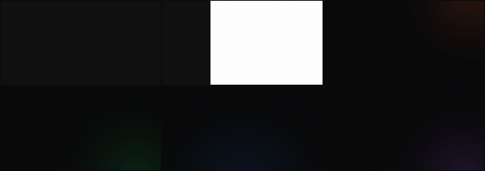
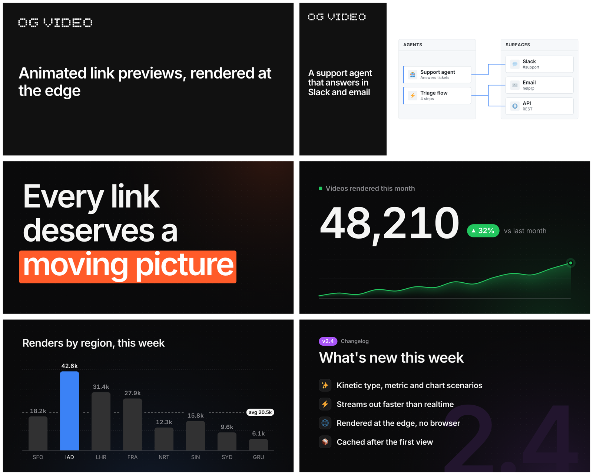

# streaming-og-video

Animated `og:video` link previews, rendered inside a Cloudflare Worker and streamed out faster than they play. No headless browser. Each distinct video renders once and is cached after that.



**Just want a URL?** Use the hosted version at **[og.video](https://og.video)**:

```html
<meta property="og:video" content="https://og.video/v1/title-card.mp4?title=We%20shipped%20it&kicker=Launch&brand=acme">
<meta property="og:video:type" content="video/mp4">
<meta property="og:video:width" content="960">
<meta property="og:video:height" content="504">
<meta property="og:image" content="https://og.video/v1/title-card.png?title=We%20shipped%20it&kicker=Launch&brand=acme">
```



## How it works

```
request ──► Worker
             ├─ edge cache (Cache API) hit ─────────────► MP4, ~2 ms
             ├─ R2 hit ─────────────────────────────────► MP4, streamed
             └─ miss:
                  1. write the prefix: the opening frames, pre-encoded once per prefix key
                  2. render the rest live, one fragment per frame:
                       scene timeline (GSAP on plain objects)
                         → Rust/wasm compositor (tiny-skia + SIMD): cached sprites and layers,
                           transformed draws, masks, blend modes, blur, dot fields, images,
                           converts to I420, flags unchanged 16×16 blocks
                         → x264 (wasm, SIMD128 kernels) encodes only what changed
                         → moof/mdat fragment → response
                  3. store the finished file in R2 + the edge cache
```

- **Starts instantly.** A scenario declares how many opening frames depend only on a few params (its *prefix*). Those frames are encoded once per prefix key, kept in R2 and isolate memory, and written before any rendering. Players start on the prefix while the rest renders.
- **Faster than realtime.** A 7 s, 960×504, 60 fps card renders in about 200–500 ms on a laptop and well under its playing time at the edge. The compositor rasterizes shapes once; frames whose state hasn't changed are skipped; blocks nothing touched are skipped by the encoder.
- **Renders once.** The cache key is the params' content hash, the scenario version and the engine version. A render that skipped frames under load is never stored, so the cached copy is always complete.
- **Plays on iPhones.** Byte ranges are served from the cached file, or from a full render that is byte-identical to it, which is what iOS Safari needs.
- **Bounded.** One compositor + encoder per isolate (about 38 MB of the 128 MB limit), renders queued FIFO, and frame skipping by queue depth under bursts, because Workers have no clock to measure lag with.

## Self-host it

```sh
npm install github:runtypelabs/og-video
```

```js
// src/index.js
import { createHandler, kvStore } from 'streaming-og-video/worker'
import { titleCard, diagram } from 'streaming-og-video/scenarios'

export default createHandler({
  scenarios: [titleCard, diagram],
  bucket: 'RENDERS',                               // R2: rendered videos, posters, prefixes
  store: kvStore({ kv: 'STATE', r2: 'RENDERS' }),  // KV: stored params for short URLs
  secret: 'OGV_SECRET',                            // signed URLs (&sig=) and write token
  rateLimit: 'RENDER_LIMIT',                       // per-IP limit on cache misses
})
```

`examples/worker/wrangler.jsonc` has the bindings. Wasm and fonts load through wrangler's default module rules, so there's nothing else to configure. With a secret set, inline params must be signed. Mint URLs with `videoUrl(origin, scenario, params, { secret })`.

### URLs

| Request | Returns |
|---|---|
| `GET /<scenario>.mp4?<params>` | The video, streamed on a miss |
| `GET /<scenario>.png?<params>` | The poster frame, for `og:image` |
| `GET /<scenario>?<params>` | A share page with `og:video` and `og:image` tags |
| `GET /<scenario>.json?<params>` | Resolved params, content id, links, and a packed `?s=` URL |
| `POST /<scenario>` (JSON body) | Stores params and returns `/<scenario>/<id>.mp4` (the id is a content hash) |
| `PUT /<scenario>/<name>` | Stores params under a name (needs the bearer token) |

Routes can live under a version prefix: `createHandler({ basePath: '/v1' })` serves `/v1/<scenario>.mp4` and uses the prefix in every link it returns (`videoUrl(..., { basePath })` does the same). Add `legacyPaths: true` to keep serving the unprefixed routes too. og.video uses `/v1`.

Params are query strings. Arrays and objects go as JSON, or as `?s=`: canonical JSON, deflated and base64url-encoded, about 3× shorter. Query keys the scenario doesn't declare, such as `utm_source`, are ignored and don't affect the cache key.

### Cloudflare primitives

| Primitive | Role |
|---|---|
| Workers | Rendering, encoding and streaming |
| Cache API | Per-location copy of finished videos |
| R2 | Global, durable store for videos, posters and prefixes. Strongly consistent, so it also backs stored params right after a write |
| Workers KV | Stored params, read at the edge. An R2 fallback covers KV's propagation delay |
| Rate Limiting | Per-IP limit on renders and public writes |
| Analytics Engine (via `onEvent`) | One event per request: cache result, client, bytes, frames, degraded renders |

## Write a scenario

A scenario is a pure function of (params, frame index). Rasterize in `setup`, and describe each frame as cached layers plus live overlays:

```js
import { gsap } from 'gsap'
import { defineScenario, p, rrect } from 'streaming-og-video'

export const hello = defineScenario({
  id: 'hello',
  version: 1,
  video: { width: 1200, height: 630, fps: 30, frames: 150 },
  params: p.object({
    title: p.string({ max: 80, default: 'Hello' }),
    accent: p.color({ default: '#3b82f6' }),
  }),
  prefix: { frames: 20, key: (q) => q.accent },   // frames 0-19 only depend on the accent
  meta: (q) => ({ title: q.title }),
  setup(ctx, q) {
    const bar = ctx.path(rrect(0, 0, 400, 8, 4))
    const title = ctx.sprite([{ cmds: ctx.text.run('semibold', q.title, 72).cmds(100, 340), color: '#fff' }], { margin: 20 })
    const s = { bar: { w: 0 }, title: { opacity: 0, blur: 8 } }
    const tl = gsap.timeline({ paused: true })
      .fromTo(s.bar, { w: 0 }, { w: 1, duration: 0.6, ease: 'expo.out' }, 0.1)
      .fromTo(s.title, { opacity: 0, blur: 8 }, { opacity: 1, blur: 0, duration: 0.4, ease: 'power3.out' }, 0.7)
    return {
      state: (i) => (tl.seek(i / ctx.fps, false), s),
      draw(g) {
        g.layer('bg', () => g.clear('#111'))                              // cached: restored by memcpy
        g.fill(bar, q.accent, { transform: [s.bar.w, 0, 0, 1, 100, 380] })  // live overlays
        g.draw(title, s.title)
      },
      dispose: () => tl.kill(),
    }
  },
})
```

Iterate locally:

```sh
npx sogv stills src/hello.js#hello --params '{"title":"Hi"}' --at 0.5,1,last   # PNGs to look at
npx sogv render src/hello.js#hello -o out/hello.mp4 --png
npx sogv bench  src/hello.js#hello                                          # ms per full render
npx sogv prefix src/hello.js#hello --vary '[{"title":"Another title"}]'    # checks the prefix contract
```

The [skill](skills/streaming-og-video/SKILL.md) covers the mental model, the full API ([authoring](skills/streaming-og-video/references/authoring.md)) and deployment ([deploy](skills/streaming-og-video/references/deploy.md)). It's written for coding agents, and people can read it too. To use it with Claude Code, copy `skills/streaming-og-video` into `.claude/skills/`.

## Built-in scenarios

| Id | What it is | Try it |
|---|---|---|
| `title-card` | An announcement card: a grid reveal, a pixel wordmark that flips into the header, a typed kicker, then the title words blur in | [og.video/v1/title-card](https://og.video/v1/title-card?title=We%20shipped%20it&kicker=Launch&brand=acme) |
| `diagram` | An architecture card: lanes of nodes wipe in, edges draw, packets travel between them, and stats count up. Nodes come from JSON or the `graph` shorthand: `Agents: Bot@bot \| Surfaces: Slack@chat` | [og.video/v1/diagram](https://og.video/v1/diagram) |
| `kinetic` | Kinetic type: a headline rises word by word, and `*starred words*` land in the accent colour with a highlight block | [og.video/v1/kinetic](https://og.video/v1/kinetic) |
| `metric` | A big number rolls up like an odometer over a trend line that draws itself, with a delta pill | [og.video/v1/metric](https://og.video/v1/metric) |
| `bars` | A bar chart grows in a staggered wave, values count up, the highlighted bar lands in the accent, and an average line sweeps across | [og.video/v1/bars](https://og.video/v1/bars) |
| `release` | Release notes: a huge version number rises behind the title, and each item slides in with its icon | [og.video/v1/release](https://og.video/v1/release) |
| `dot-matrix` | A product card whose blue panel cycles through dot-matrix icons (search, brand, map, monitor, scrape, code, chart), each dissolving in and out dot by dot with a pixel-font label | `sogv render dot-matrix` |
| `falling-words` | A dot and a label; about a hundred small words rain in at random angles, tumble and pile up (precomputed rigid-body physics), then drop out to loop | `sogv render falling-words` |
| `gallery` | A title block beside a two-column wall of thumbnails that scrolls without end. Thumbnails are `images` URLs (PNG, JPEG, WebP), or built-in illustrated tiles | `sogv render gallery` |
| `terminal` | A shell session replays: commands type out behind a block cursor, spinners resolve to a check or cross, and output prints in. `lines` mark commands with `$`, successes `+`, failures `!`, muted `>`, accent `*words*` | `sogv render terminal` |
| `pr` | A pull request: title and state pill land, diff lines type in over red and green rows, the +/- counters tick, and a Merged (or Closed) stamp lands | `sogv render pr` |
| `repo` | A repo or package card: the star count rolls up, the language bar fills, topic pills pop in, and an optional star history draws with milestone ticks | `sogv render repo` |
| `transcript` | An agent run replays: user bubbles, tool calls whose spinners resolve to a check (or a red cross for `r!:` failures), typing dots, then the answer. `chat=u: … \| t: tool(args) \| r: result \| a: answer` | `sogv render transcript` |
| `grid` | A results grid (evals, test matrices): tiles flip in a wave to pass, warn or fail with a glyph each, row tallies land, and a pass count rolls up | `sogv render grid` |
| `dither` | A dithered aurora in the accent colour rises in Bayer order and keeps flowing at 60 fps, re-dithered every frame against a fixed matrix; the title dithers in, then resolves to solid type. After dithercn's Aurora | `sogv render dither` |
| `race` | A bar chart race: horizontal bars swap ranks across periods as values count, the axis rescales to the leader, and a big period counter rolls over | `sogv render race` |

All of them take `accent`, and `kinetic`, `metric`, `bars`, `release` and the six from `terminal` down also take `theme=light`. The last three are new in v2 and not yet on og.video, and neither is `dither`. `GET /<scenario>.json` lists the resolved params with their defaults.

## Layout

```
src/            the library (plain ESM + JSDoc; types in types/)
  scenario.js   defineScenario
  schema.js     p.* params schema (Standard Schema compatible)
  params.js     canonical JSON, content ids, packing, signatures
  gfx.js        the Scene/Frame drawing API over the compositor
  physics.js    a deterministic 2D rigid-body world, for precomputed motion
  text.js       shaping and layout with Chrome's rounding rules (fontkit)
  engine/       per-isolate engine, x264 glue, fMP4 prefix + tail, PNG, image params
  worker/       createHandler, KV/R2 store, share page
  node/         Node engine and the sogv CLI
  scenarios/    built-in scenarios
crates/ogfx/    the Rust compositor (npm run build:ogfx)
x264/           x264 wasm build (npm run build:x264), with SIMD128 kernels checked against x264's C
wasm/, fonts/   built artifacts, Inter and JetBrains Mono
```

## Limits

- **Safari doesn't stream.** iOS fetches ranges, so the first view on an iPhone waits for a full render (about 0.2–0.6 s at the edge). Later views are cache hits.
- **Bursts on a cold key.** Many concurrent requests for different new videos in one isolate share one engine. Live tails then skip frames, which looks choppy, and those renders aren't cached. A longer prefix gives more headroom.
- **2D graphics only.** The compositor does vector fills with solid or gradient paint, sprites with any affine transform, blur, masks, blend modes, shadows, dot fields, decoded images and layers. It doesn't do footage or 3D.
- **Full-frame motion costs encode time.** A frame where half the picture moves costs about 0.5–1 ms in x264 alone, so scenes that move a lot every frame (`gallery`, `falling-words`) take 0.3–0.5 s per 7 s at 60 fps locally, and `falling-words` is about 3.5 MB. Lower `video.fps` for scenes like that if size or render time matters more than smoothness.
- **Image params are fetched by the Worker.** They are capped in size and count, cached per isolate, and a render missing one is served but never cached. If the image at a URL changes, cached videos keep the old one; change the URL to refresh it.

## Roadmap

- **A permissively licensed encoder.** Evaluate [minih264](https://github.com/lieff/minih264) (CC0) behind the encoder interface. It needs a per-macroblock skip hint like x264's `mb_info`, and enough speed in wasm.
- **Compositor:**
  - strokes;
  - static and cycling film grain (bitrate-safe: baked or at ≤8 fps);
  - a blob "mesh" gradient helper;
  - directional motion blur and perspective (2.5D) card warps.
- **Footage plates:** H.264 decode in wasm for video backgrounds and pre-rendered 3D loops, behind a container step that normalises uploads (see the v2 plan).
- **A per-frame cost check in CI:** fail when a scenario's p95 frame cost passes a budget.
- **Bundled prefixes:** build prefixes for known keys at deploy time (`sogv prefix build`), so even the first request for a key is instant.
- **Heavier scenes:** footage, 3D, full-frame effects. These probably belong in a GPU or container tier that renders once into the same R2 cache, while the Worker keeps streaming.

## License

MIT, except `wasm/x264.wasm`, which is GPL-2.0-or-later. That matters if you redistribute builds that include it; see [NOTICE.md](NOTICE.md). Inter is OFL-1.1 and Twemoji outlines are CC-BY 4.0.
